<p align="center">
  <picture>
    <source media="(prefers-color-scheme: dark)" srcset="assets/branding/wattkin-logo-dark.svg">
    
  </picture>
</p>

A small tray app that replaces MSI Center on MSI laptops. It shows how many watts your laptop is using right in the taskbar, and controls the things worth controlling: charge limits, battery calibration, performance and fan modes, the keyboard light, the special keys and the NVIDIA GPU. No background services, no account and no telemetry.

| | MSI Center | Wattkin |
| --- | --- | --- |
| Processes running | 8 | 1 |
| Memory used | 675 MB | 20 MB |
| Installed size | 260 MB | 1 MB |

<sub>Measured on the same MSI Prestige 16 Studio: MSI Center with its background services running, Wattkin with just its tray icon (about 0.1% CPU). Memory is private memory. Sizes leave out MSI Center's Microsoft Store app and the .NET runtime Wattkin uses.</sub>

<p align="center">
  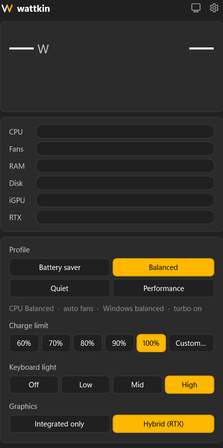
  &nbsp;
  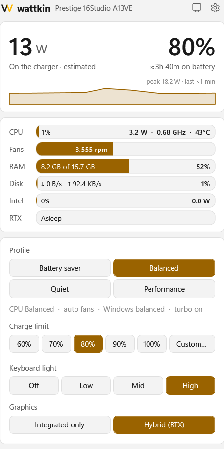
</p>

The tray icon *is* the reading:

<p align="center">
  
  &nbsp;
  
</p>

## About this fork

This is a fork of [CoppingEthan/Wattkin](https://github.com/CoppingEthan/Wattkin) with three changes:

- **No updater, no network.** The upstream app downloaded signed releases from the original repository and replaced itself, which would overwrite this fork's build. That code is gone: this build never talks to the network.
- **Full fan tables on the MSI Stealth 15M A11UEK** (EC firmware `1563EMS1.115`): fan profiles set each step's speed, the temperature that moves the fan up to it and the temperature that moves it back down (hysteresis), like [YAMDCC](https://codeberg.org/Sparronator9999/YAMDCC). The register map comes from YAMDCC's configuration for this laptop.
- **A hardware self-test** (`tools\selftest.ps1`) that checks every control on the laptop, then puts everything back.

## Install

Build it from source (see [Building from source](#building-from-source)), then run `.\install.ps1`, or run `dist\Wattkin.exe` and click **Install**.

Wattkin installs itself and starts with Windows. To update, build the newer version and install it the same way. It needs the [.NET 10 Desktop Runtime](https://dotnet.microsoft.com/download/dotnet/10.0), which Windows offers to download if it's missing.

To uninstall, go to **Settings › Apps › Installed apps › Wattkin**. Your Windows power settings are put back and the battery charges to 100% again.

### MSI Center

You don't need MSI Center, and you never need to install it. If it's already on your laptop, uninstall it once Wattkin is set up: **MSI Center** in **Settings › Apps**, along with **MSI NBFoundation Service** and **MSI Center SDK** if they're listed, then restart. Running both makes them fight over the same settings.

## Features

- **Watts at a glance** - What the whole laptop is drawing right now, in the tray icon, a flyout and an optional desktop widget, with the battery time left.
- **Charge limits** - Stop charging anywhere from 10% to 100%, charge to 100% once for a long day away, or bring the battery down to the limit while plugged in.
- **Battery health** - Capacity, health and history, plus MSI's calibration for when the battery gauge drifts.
- **Profiles** - CPU power, fans, Windows power mode, turbo, refresh rate and keyboard light, each set separately. Profiles switch by themselves when you plug in or unplug. On the Prestige 16 Studio, Quiet keeps the fans off until the CPU reaches 60°C.
- **Fan profiles** - Make named fan curves, each fan's speed at each of the laptop's temperature steps, and pick one in any profile. Fans can also be set to full speed, or off (experimental). Safety rules keep the fans ahead of the heat unless you accept the experimental mode, if you'd rather let the laptop run hot and throttle.
- **Monitoring** - CPU, Intel graphics and RTX load and watts, temperatures, fans, RAM and disk.
- **Keyboard and keys** - Backlight brightness and auto-off. The mic-mute key, the mute lights and the MSI keys keep working without MSI Center.
- **NVIDIA GPU** - See whether the RTX is asleep or working, and switch between Hybrid and Integrated-only.
- **Simple and Expert settings** - One simple page for everyday use, and an Expert view with every control and a Debug tab for fan tests and diagnostics.

<p align="center">
  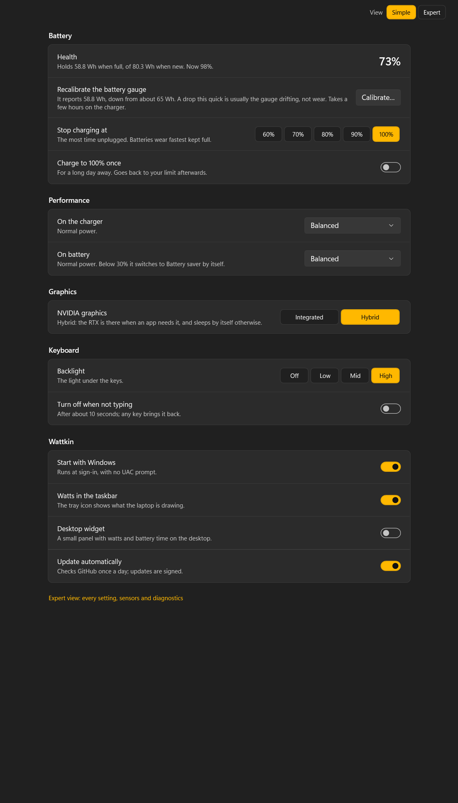
</p>

<details>
<summary>More screenshots</summary>

| Simple view (light) | Desktop widget |
| --- | --- |
| 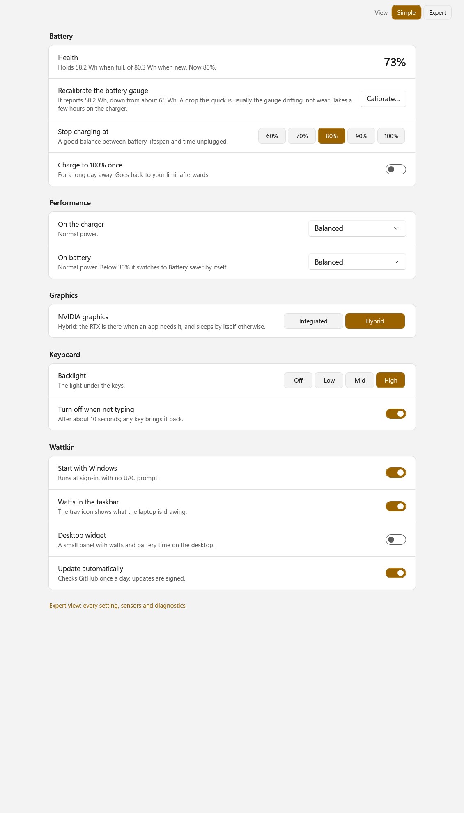 | 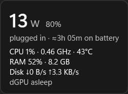 |

| Expert view | |
| --- | --- |
| 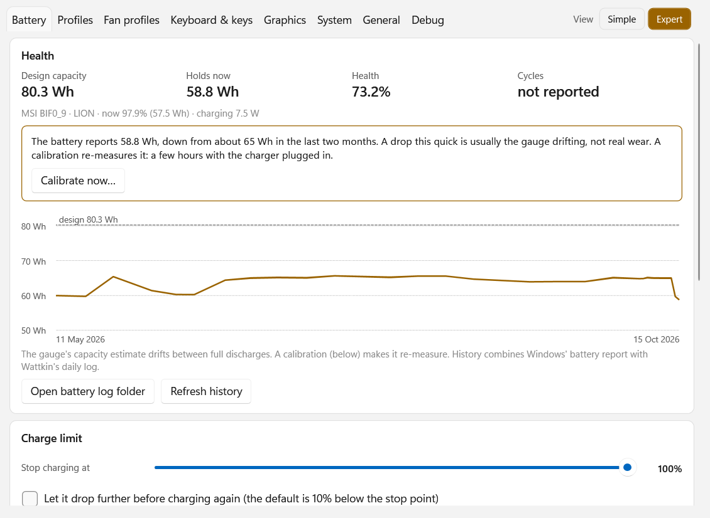 | 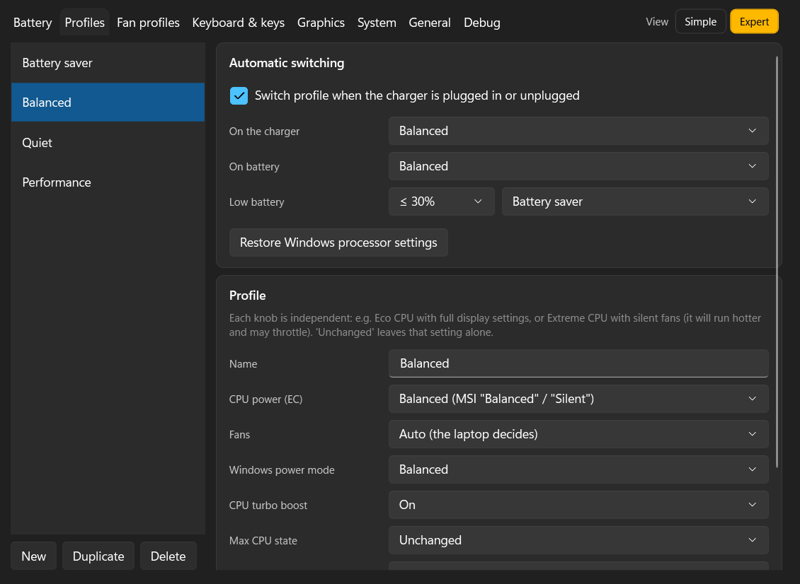 |
| 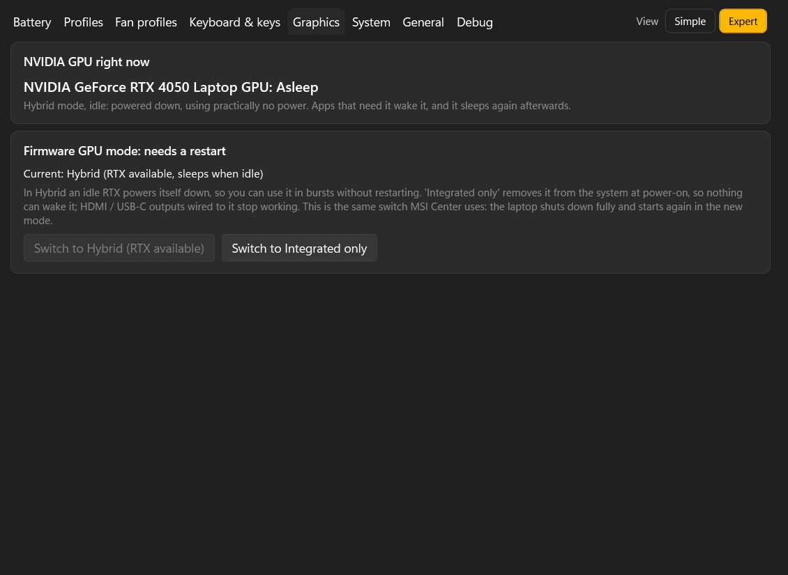 | 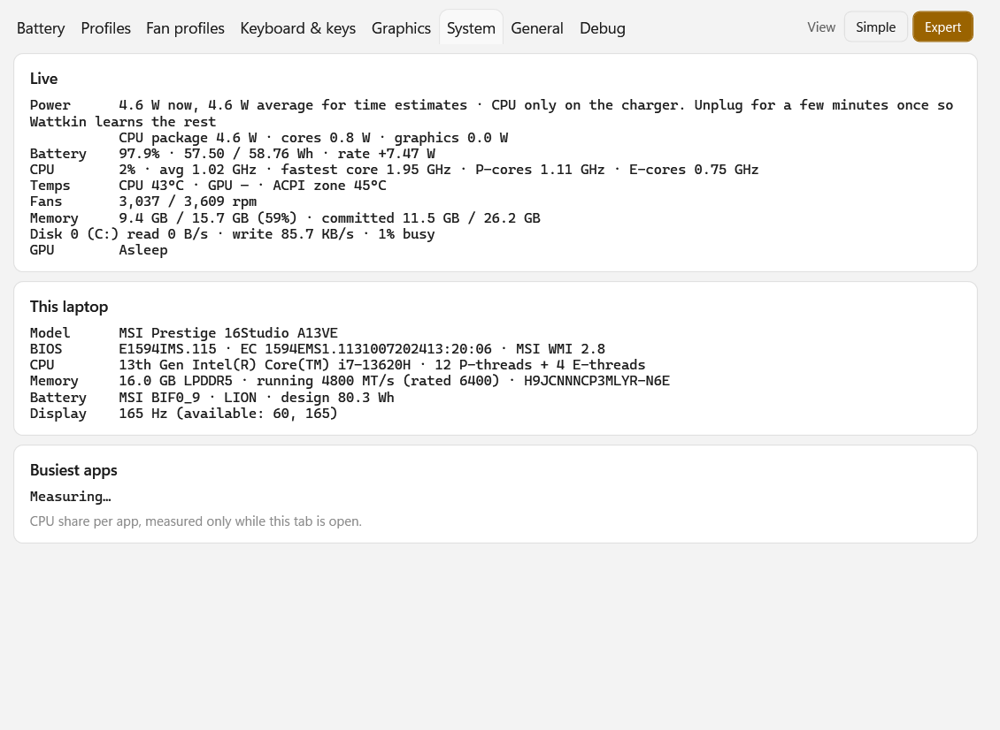 |
| 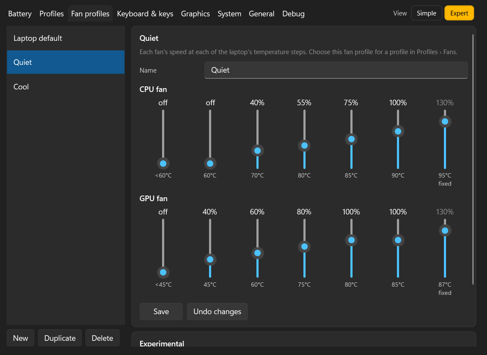 | 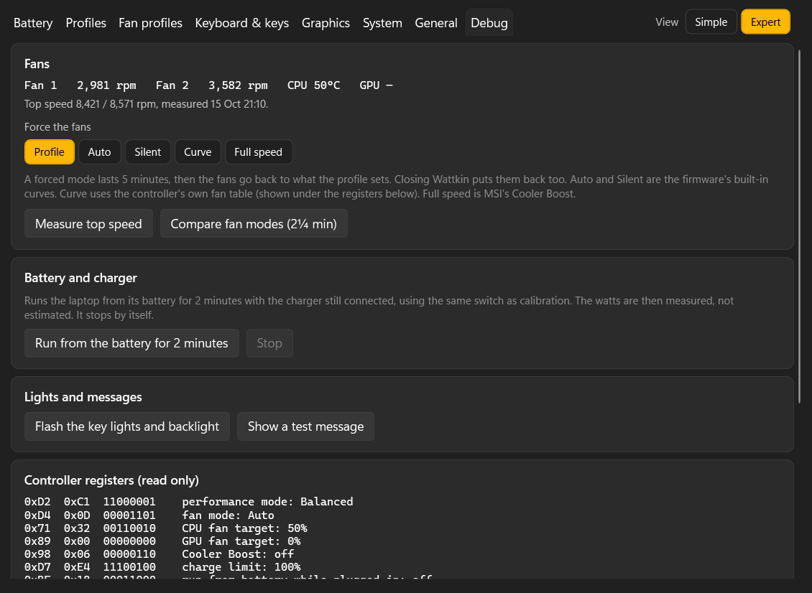 |
</details>

## Supported laptops

| Laptops | What works |
| --- | --- |
| MSI Stealth 15M A11UEK (EC `1563EMS1.115`) | Everything, with whole fan tables (temperatures and hysteresis). Run the hardware self-test before relying on it |
| MSI Prestige 16 Studio A13VE | Everything, tested on the real laptop by the upstream author |
| Other recent MSI laptops, including those known to the Linux [msi-ec](https://github.com/BeardOverflow/msi-ec) project | Everything the laptop supports, after a safety check at startup |
| Older MSI laptops, the newest MSI laptops (firmware interface version 3), and other brands | Watts, battery and system readings, without hardware controls |

Only the Prestige 16 Studio has been tested so far. If you try Wattkin on another MSI laptop, please [open an issue](https://github.com/CoppingEthan/Wattkin/issues/new/choose) with a diagnostics report. When hardware controls aren't available, the flyout has a button that saves one to your desktop.

## How it works

Wattkin talks to the laptop through the same firmware interface MSI Center uses, so it needs no driver. Windows only knows that interface once it has been described to it. MSI Center does that with a file of its own, while Wattkin brings its own description, so it works on a Windows install that has never had MSI software. It only changes hardware settings on firmware it recognises, and it logs every change.

Nothing leaves your laptop: this fork has no network code at all. Settings are kept in `%APPDATA%\Wattkin` and logs in `%LOCALAPPDATA%\Wattkin`.

## Building from source

You need the [.NET 10 SDK](https://dotnet.microsoft.com/download/dotnet/10.0). In PowerShell:

```powershell
git clone https://github.com/Balmor40/Wattkin.git
cd Wattkin
.\build.ps1     # runs the tests, then builds .\dist\Wattkin.exe
.\install.ps1   # installs your build
```

### Hardware self-test

`.\tools\selftest.ps1` checks the build against the laptop. Stop YAMDCC first (`Stop-Service yamdccsvc`) and close any running Wattkin: two programs writing the embedded controller would spoil the results.

1. **Read**: the firmware interface, the register map, the sensors, and the fan table read two ways (registers and MSI's own calls), which must agree. Nothing is written to the controller.
2. **Write** (after a prompt, about 4 minutes, charger connected, laptop idle): each control is changed, checked and put back, including fan tables and their hysteresis. Every register it touches is saved first and restored at the end.

Reports are saved in `%LOCALAPPDATA%\Wattkin\selftest`.

## Tech Stack

- **App:** C# on .NET 10, WPF with the Windows 11 theme
- **Hardware:** MSI's firmware interface (WMI), Windows battery and performance counters
- **Dependencies:** One (System.Management)
- **Tests:** xUnit

## Why I Built This

MSI Center does a handful of genuinely useful things, like charge limits, fan and performance modes and the GPU switch. They're buried under hardware monitors, gaming modes and support pages, running as several background processes, and its presets bundle settings together. I wanted just the useful parts, each on its own switch, in something light enough to forget it's running.

## Development & AI Usage

This project was built with AI coding agents. I came up with the idea, the features and the branding, and tested every hardware feature on my own laptop. The agents worked out how MSI Center talks to the firmware (from MSI Center's own logs and modules on my installed copy, cross-checked with the open-source projects below), wrote the code, and reviewed it for bugs in several rounds. Hardware writes were only switched on once they'd been checked on the real laptop.

## Credits

The hardware knowledge builds on [msi-ec](https://github.com/BeardOverflow/msi-ec), the Linux `msi-wmi-platform` driver documentation, [MControlCenter](https://github.com/dmitry-s93/MControlCenter) and [MsiGT](https://github.com/tim-rue/MsiGT). MSI Center's behaviour was studied from the copy installed on my own laptop, for interoperability, with [ILSpy](https://github.com/icsharpcode/ILSpy) used to read its .NET modules.

Wattkin is not affiliated with or endorsed by MSI.

## License

Copyright © 2026 Ethan Copping. Wattkin is free software: you can redistribute it and/or modify it under the terms of the [GNU General Public License, version 3 or later](LICENSE). It comes with no warranty.

## Author

Ethan Copping
